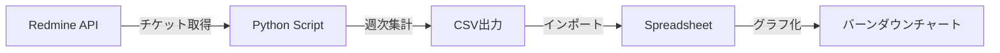
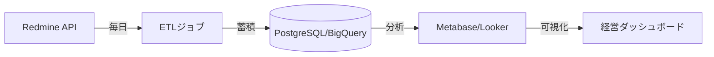

# Redmine進捗管理ベストプラクティスガイド

> 完全版: 日次・週次・月次のチケット管理とバーンダウンチャート活用

---

## 目次

1. [概要](#概要)
2. [アジャイル開発の基礎](#アジャイル開発の基礎)
3. [日次進捗管理](#日次進捗管理)
4. [週次進捗管理](#週次進捗管理)
5. [月次進捗管理](#月次進捗管理)
6. [バーンダウンチャート実装](#バーンダウンチャート実装)
7. [自動化戦略](#自動化戦略)
8. [トラブルシューティング](#トラブルシューティング)
9. [改善提案](#改善提案)

---

## 概要

### 目的

プラグインが少ないRedmine環境で、日次・週次・月次の3段階進捗管理を確立し、アジャイル開発手法を適用したバーンダウンチャート風の可視化を実現します。

### このガイドで達成できること

- 日次: チケット更新と進捗の即時把握
- 週次: スプリントベースのバーンダウンチャート
- 月次: プロジェクト全体の健全性分析
- 自動化: REST API連携による手作業の最小化
- 可視化: Excel/Google Spreadsheetでの高度なダッシュボード

---

## アジャイル開発の基礎

### スクラム用語のマッピング

| スクラム用語 | Redmine実装 |
|------------|------------|
| **スプリント** | バージョン（1〜2週間） |
| **プロダクトバックログ** | トラッカー: 機能 |
| **スプリントバックログ** | バージョン内のチケット |
| **タスク** | トラッカー: タスク |
| **バグ** | トラッカー: バグ |
| **ストーリーポイント** | カスタムフィールド: SP |
| **ベロシティ** | 週次完了SP数 |

### 推奨チケット粒度

```text
【親チケット】ユーザーストーリー（1〜2週間）
├── 【子チケット】タスク1（1〜3日）
├── 【子チケット】タスク2（1〜3日）
└── 【子チケット】タスク3（1〜3日）
```

ベストプラクティス。

- タスクチケットは1週間以内で完了する粒度
- 前フェーズで次のチケットを作成
- 見積もりは予定工数またはストーリーポイントで管理

---

## 日次進捗管理

### 1. デイリースタンドアップ（15分）

#### タイムボックス構成

```text
09:00-09:15 デイリースタンドアップ
├── 各メンバー（1人1分）
│ ├── 昨日やったこと
│ ├── 今日やること
│ └── ブロッカー（障害）
└── アクションアイテム確認
```

#### Redmineでの実装

- カスタムクエリ1: 自分の今日の作業

```sql
フィルタ:
- 担当者: 自分
- ステータス: 進行中
- 更新日: 過去1日
- ソート: 優先度（降順）
```

- カスタムクエリ2: ブロッカー検出

```sql
フィルタ:
- プロジェクト: 全体
- カスタムフィールド「ブロッカー」: Yes
- ステータス: ≠ 終了
- ソート: 優先度（降順）
```

### 2. チケット更新ルール

#### 必須更新項目（毎日）

- 進捗率: ステータス自動更新または手動入力
- 注記: 作業内容の簡潔な記録（50文字程度）
- 作業時間: 実績工数の記録

#### 進捗率自動更新設定

```ruby
# 管理 → 設定 → チケットトラッキング
ステータスによる進捗率の自動更新:
- 新規: 0%
- 進行中: 10%
- フィードバック: 50%
- 解決: 80%
- 終了: 100%
```

### 3. カンバンボード（視覚管理）

```text
┌──────────┬──────────┬──────────┬──────────┐
│ 新規 │ 進行中 │ レビュー │ 完了 │
├──────────┼──────────┼──────────┼──────────┤
│ #123 機能│ #124 機能│ #125 バグ│ #126 機能│
│ #127 タスク│ #128 タスク│ │ #129 タスク│
│ │ │ │ │
│ WIP: 2 │ WIP: 2 │ WIP: 1 │ Done: 2 │
└──────────┴──────────┴──────────┴──────────┘
```

WIP制限のベストプラクティス。

- 1人あたり同時進行は2〜3チケットまで
- チーム全体で進行中 ≤ メンバー数×2

---

## 週次進捗管理

### 1. スプリント計画（週初・月曜午前）

#### アジェンダ（60分）

```text
09:00-10:00 スプリント計画
├── 前スプリント振り返り（15分）
│ ├── ベロシティ確認
│ ├── 完了率の確認
│ └── 改善アクション
├── 今スプリント計画（35分）
│ mange Backlogからチケット選択
│ ├── 見積もり調整
│ ├── 担当者アサイン
│ └── スプリント目標設定
└── 質疑応答（10分）
```

#### カスタムクエリ3: 前週完了チケット

```sql
フィルタ:
- ステータス: 終了
- 更新日: 過去7日
- グループ化: 担当者
- 集計: 予定工数の合計
```

#### カスタムクエリ4: 今週のスプリントバックログ

```sql
フィルタ:
- 対象バージョン: Sprint-W48（例）
- ステータス: ≠ 終了
- ソート: 優先度（降順）
```

### 2. バーンダウンチャート（毎日更新）

#### 自動生成フロー



#### データ項目（CSV）

```csv
週番号,完了チケット数（累積）,残チケット数,完了工数（累積）,残工数,理想残チケット数,理想残工数
2025-W41,3,97,0,0,87.5,0
2025-W42,6,94,0,0,75,0
2025-W43,10,90,0,0,62.5,0
```

### 3. 週次レビュー（週末・金曜午後）

#### アジェンダ（45分）

```text
15:00-15:45 週次レビュー
├── バーンダウンチャート確認（10分）
│ ├── 実績線 vs 理想線
│ ├── ベロシティ計算
│ └── 完了予測日
├── デモ（20分）
│ └── 完了した機能の実演
├── レトロスペクティブ（15分）
│ ├── Keep（良かったこと）
│ ├── Problem（課題）
│ └── Try（改善案）
```

#### ベロシティ計算式

```excel
// 週次ベロシティ（完了チケット数/週）
=COUNTIFS(マスター!$M:$M,A2,マスター!$K:$K,1)

// 平均ベロシティ（過去4週平均）
=AVERAGE(B2:B5)

// 完了予測日（残作業÷平均ベロシティ）
=TODAY()+残チケット数/平均ベロシティ*7
```

---

## 月次進捗管理

### 1. 月次レポート生成

#### 必須指標（KPI）

| 指標名 | 計算式 | 目標値 |
|-------|--------|--------|
| **完了率** | 完了チケット数 ÷ 総チケット数 | ≥ 80% |
| **平均ベロシティ** | 月間完了SP ÷ 週数 | 安定（±20%以内） |
| **バグ率** | バグチケット数 ÷ 総チケット数 | ≤ 15% |
| **リードタイム** | 完了日 - 作成日の平均 | ≤ 14日 |
| **サイクルタイム** | 完了日 - 開始日の平均 | ≤ 7日 |
| **ブロック率** | ブロック日数 ÷ 総日数 | ≤ 10% |

#### カスタムクエリ5: 月次サマリー

```sql
フィルタ:
- 更新日: 今月
- グループ化: ステータス
- 集計:
- チケット数
- 予定工数の合計
- 実績工数の合計
```

### 2. 累積フロー図（CFD）

#### データ収集（週次スナップショット）

```csv
日付,新規,進行中,レビュー中,完了
2025-11-01,20,15,5,10
2025-11-08,18,12,8,12
2025-11-15,15,10,7,18
2025-11-22,12,8,5,25
```

#### グラフ化（積み上げ面グラフ）

```text
50│ ┌────────── 完了
│ ┌───┤
40│ ┌───┤ │
│ ┌───┤ │ │
30│ ┌───┤ │ │ │
│┌───┤ │ │ │ │
20││ │ │ │ │ │
││ │ │ │ │ │
10││ │ │ │ │ │
││ │ │ │ │ │
0└┴───┴───┴───┴───┴───┴─
W1 W2 W3 W4 W5
```

CFDから読み取れる情報。

- 横幅の増大 → ボトルネック発生
- 縦幅の増大 → スコープクリープ
- 斜め上昇 → 健全な進捗

### 3. ベースライン管理

#### ベースライン保存タイミング

```text
月初（1日）:
1. 全チケットデータをCSVエクスポート
2. ファイル名: baseline_YYYYMM.csv
3. Gitリポジトリにコミット
4. 前月との差分レポート生成
```

#### 差分分析SQL

```sql
-- 新規追加チケット
SELECT * FROM issues
WHERE created_on >= '2025-11-01'
AND created_on < '2025-12-01';

-- スコープ変更（工数増減）
SELECT
id,
subject,
estimated_hours_old,
estimated_hours_new,
(estimated_hours_new - estimated_hours_old) AS diff
FROM issue_changes
WHERE updated_on >= '2025-11-01';
```

---

## バーンダウンチャート実装

### 方法1: 基本版（手動更新）

#### ステップ1: Redmineからデータ取得

必須項目。

```text
チケット番号 (#)
題名
ステータス
優先度
担当者
作成日
更新日
開始日
期日
進捗率 (%)
予定工数
対象バージョン
```

CSVエクスポート手順。

1. チケット一覧 → オプション → 項目選択
2. 「選択された項目」を選択
3. エンコーディング: UTF-8
4. エクスポート実行

#### ステップ2: Spreadsheet自動化

シート構成。

```text
シート1: 【RAW】CSVインポート用
シート2: 【週次】バーンダウンチャート
シート3: 【月次】累積フロー図
シート4: 【ダッシュボード】KPI一覧
```

自動計算式（Google Spreadsheet）。

```javascript
// A列: 週番号（自動生成）
=UNIQUE(FILTER(RAW!M:M,RAW!M:M<>""))

// B列: 完了チケット数（累積）
=ARRAYFORMULA(
IF(A2:A="",,
COUNTIFS(RAW!$M:$M,"<="&A2:A,RAW!$K:$K,1)
)
)

// C列: 残チケット数
=ARRAYFORMULA(
IF(A2:A="",,
COUNTA(RAW!A:A)-B2:B-1
)
)

// D列: 完了工数（累積）
=ARRAYFORMULA(
IF(A2:A="",,
SUMIFS(RAW!$I:$I,RAW!$M:$M,"<="&A2:A,RAW!$K:$K,1)
)
)

// E列: 残工数
=ARRAYFORMULA(
IF(A2:A="",,
SUM(RAW!$I:$I)-D2:D
)
)

// F列: 理想線（線形減少）
=ARRAYFORMULA(
IF(A2:A="",,
$E$2*(1-ROW(A2:A)/COUNTA(A:A))
)
)
```

### 方法2: 完全自動版（Python + REST API）

#### 本プロジェクトの実装

```bash
# 1. 環境変数設定
cat > .env <<EOF
REDMINE_URL=https://your-redmine.com
REDMINE_API_KEY=your-api-key
EOF

# 2. チケット取得 + CSV生成
uv run python -m redmine_burndown.redmine_client

# 3. バーンダウンデータ生成
uv run python -m redmine_burndown.burndown_analyzer

# 4. 出力確認
ls -lh output/
# redmine_issues_YYYYMMDD_HHMMSS.csv
# burndown_weekly.csv
# status_summary_weekly.csv
```

#### 週次自動実行（cron設定）

```bash
# crontab -e
# 毎週月曜日 09:00に実行
0 9 * * 1 cd /path/to/redmine-burndown && ./update_burndown.sh
```

#### update_burndown.sh（エラーハンドリング強化版）

```bash
#!/bin/bash
set -euo pipefail

# 環境変数チェック
if [ ! -f .env ]; then
echo " エラー: .envファイルが見つかりません"
exit 1
fi

# チケット取得
echo " チケットデータ取得中..."
if ! uv run python -m redmine_burndown.redmine_client; then
echo " エラー: チケット取得に失敗しました"
exit 1
fi

# バーンダウン生成
echo " バーンダウンデータ生成中..."
if ! uv run python -m redmine_burndown.burndown_analyzer; then
echo " エラー: バーンダウン生成に失敗しました"
exit 1
fi

echo " 完了！出力: output/"
```

---

## 自動化戦略

### レベル1: スクリプト自動化（本プロジェクト）

対象。

- チケットデータ取得
- CSV生成
- 週次集計

技術スタック。

- Python 3.11+
- uv (パッケージ管理)
- Redmine REST API
- python-dotenv

### レベル2: Google Apps Script連携

#### 自動インポート + グラフ更新

```javascript
/**
* Redmine APIからデータ取得してSpreadsheetに自動反映
*/
function updateFromRedmineAPI() {
const apiKey = PropertiesService.getScriptProperties()
.getProperty('REDMINE_API_KEY');
const redmineUrl = PropertiesService.getScriptProperties()
.getProperty('REDMINE_URL');

// APIリクエスト
const url = `${redmineUrl}/issues.json?status_id=*&limit=100`;
const options = {
'method': 'get',
'headers': {
'X-Redmine-API-Key': apiKey
},
'muteHttpExceptions': true
};

const response = UrlFetchApp.fetch(url, options);
const data = JSON.parse(response.getContentText());

// Spreadsheetに書き込み
const ss = SpreadsheetApp.getActiveSpreadsheet();
const sheet = ss.getSheetByName('RAW');

// データクリア
sheet.getRange('A2:Z').clearContent();

// データ書き込み
const rows = data.issues.map(issue => [
issue.id,
issue.subject,
issue.status.name,
issue.priority.name,
issue.assigned_to?.name || '',
issue.created_on,
issue.updated_on,
issue.start_date || '',
issue.due_date || '',
issue.done_ratio,
issue.estimated_hours || 0,
issue.fixed_version?.name || ''
]);

if (rows.length > 0) {
sheet.getRange(2, 1, rows.length, rows[0].length).setValues(rows);
}

Logger.log(` ${rows.length}件のチケットを更新しました`);
}

/**
* 週次トリガー設定
*/
function createWeeklyTrigger() {
// 既存トリガー削除
const triggers = ScriptApp.getProjectTriggers();
triggers.forEach(trigger => ScriptApp.deleteTrigger(trigger));

// 新規トリガー作成（毎週月曜日09:00）
ScriptApp.newTrigger('updateFromRedmineAPI')
.timeBased()
.onWeekDay(ScriptApp.WeekDay.MONDAY)
.atHour(9)
.create();

Logger.log(' 週次トリガーを設定しました');
}
```

### レベル3: CI/CD統合

#### GitHub Actions例

```yaml
name: Weekly Burndown Update

on:
schedule:
# 毎週月曜日 09:00 JST (00:00 UTC)
- cron: '0 0 * * 1'
workflow_dispatch: # 手動実行も可能

jobs:
update-burndown:
runs-on: ubuntu-latest

steps:
- uses: actions/checkout@v4

- name: Setup Python
uses: actions/setup-python@v5
with:
python-version: '3.11'

- name: Install uv
run: curl -LsSf https://astral.sh/uv/install.sh | sh

- name: Install dependencies
run: uv sync

- name: Run burndown update
env:
REDMINE_URL: ${{ secrets.REDMINE_URL }}
REDMINE_API_KEY: ${{ secrets.REDMINE_API_KEY }}
run: |
uv run python -m redmine_burndown.redmine_client
uv run python -m redmine_burndown.burndown_analyzer

- name: Commit and push
run: |
git config user.name "GitHub Actions"
git config user.email "actions@github.com"
git add output/
git commit -m " 週次バーンダウン更新 $(date +%Y-%m-%d)"
git push
```

---

## トラブルシューティング

### 問題1: 週番号がずれる

症状。

```text
Excel: 2025-W48
GSheet: 2025-W47
```

原因: ISO 8601とGoogle Spreadsheetで週の定義が異なる

解決策。

```excel
# Excel（ISO 8601: 月曜始まり）
=YEAR(E2)&"-W"&TEXT(WEEKNUM(E2,21),"00")

# Google Spreadsheet（月曜始まり）
=YEAR(E2)&"-W"&TEXT(WEEKNUM(E2,2),"00")

# Python（ISO週番号）
from datetime import datetime
dt = datetime.fromisoformat("2025-11-26")
iso_week = dt.isocalendar()
print(f"{iso_week[0]}-W{iso_week[1]:02d}") # 2025-W48
```

### 問題2: CSVの文字化け（macOS Excel）

症状: 日本語が「譁�蟄怜喧縺�」のように表示

原因: ExcelがUTF-8を正しく認識しない

解決策。

```python
# BOM付きUTF-8で出力（本プロジェクト実装済み）
with Path("output.csv").open("w", encoding="utf-8-sig") as f:
writer = csv.writer(f)
writer.writerow(["週番号", "完了チケット数"])
```

検証。

```bash
# BOMの確認（先頭3バイトが EF BB BF）
hexdump -C output.csv | head -1
# 00000000 ef bb bf e9 80 b1 e7 95 aa e5 8f b7
# ^^^^^^^^ ← UTF-8 BOM
```

### 問題3: 日付が数値になる

症状。

```text
期待: 2025-11-26
実際: 45266
```

原因: Excelが日付をシリアル値として解釈

解決策。

```excel
# A. 列の書式を「日付」に変更
列を選択 → 右クリック → セルの書式設定 → 日付

# B. TEXT関数で強制的に文字列化
=TEXT(A2,"YYYY-MM-DD")

# C. CSVインポート時に「テキスト」を指定
データ → テキストファイル → ウィザード → 列のデータ形式: テキスト
```

### 問題4: 理想線が引けない

症状: バーンダウンチャートで理想線が表示されない

原因: 開始時の総作業量が未確定

解決策。

```excel
# スプリント開始時の総工数を記録
初期総工数: =SUM(RAW!I:I) # 例: 100時間
総週数: 4週間

# 理想線（線形減少）
=初期総工数*(1-ROW()/総週数)

# 週1: 100*(1-1/4) = 75
# 週2: 100*(1-2/4) = 50
# 週3: 100*(1-3/4) = 25
# 週4: 100*(1-4/4) = 0
```

### 問題5: ベロシティが安定しない

症状: 週ごとの完了数が 2 → 15 → 3 → 12 のように大きく変動

原因。

- チケット粒度が不均一
- 見積もり精度が低い
- ブロッカーの影響

解決策。

```text
1. チケット粒度の統一
- 1チケット = 1〜3日以内
- 親子関係を活用

2. 見積もり手法の改善
- プランニングポーカー導入
- ストーリーポイント導入
- 過去実績からの類推

3. ブロッカー早期検出
- デイリースタンドアップで確認
- カスタムフィールド「ブロック理由」追加
- エスカレーションルール明確化
```

---

## 改善提案

### 短期（今月中に実装）

#### 1. カスタムフィールド追加

```ruby
# 管理 → カスタムフィールド → 新規作成

【フィールド1】ストーリーポイント
- 形式: 整数
- 対象: チケット
- デフォルト値: 1
- 必須: Yes

【フィールド2】ブロッカー
- 形式: 真偽値
- 対象: チケット
- デフォルト値: No

【フィールド3】ブロック理由
- 形式: テキスト
- 対象: チケット
- 表示条件: ブロッカー = Yes
```

#### 2. ステータスワークフロー最適化

```text
新規 → 進行中 → レビュー中 → 解決 → 終了
↓ ↓ ↓
└──────┴──────────┴→ 却下/保留
```

#### 3. 通知ルール設定

```ruby
# 管理 → 設定 → メール通知

【高優先度】即時通知:
- ブロッカーがYesになった
- 優先度が「緊急」に変更された
- 期日が過ぎた

【中優先度】日次ダイジェスト:
- 自分が担当者のチケットが更新された
- 自分がウォッチャーのチケットが更新された

【低優先度】週次サマリー:
- プロジェクト全体の進捗レポート
```

### 中期（3ヶ月以内）

#### 1. プラグイン導入検討

| プラグイン名 | 用途 | 優先度 |
|------------|------|--------|
| **Redmine Agile** | カンバンボード、バーンダウン | 高 |
| **Redmine Dashboard** | ダッシュボード強化 | 中 |
| **Redmine Checklists** | チェックリスト機能 | 中 |
| **Redmine Code Review** | コードレビュー統合 | 低 |

#### 2. データウェアハウス化



#### 3. 機械学習による予測

```python
# 完了予測モデル（線形回帰）
import pandas as pd
from sklearn.linear_model import LinearRegression

# 過去データ読み込み
df = pd.read_csv("historical_burndown.csv")

# 特徴量: 経過週数、残チケット数、平均ベロシティ
X = df[['week_number', 'remaining_tickets', 'avg_velocity']]
y = df['completion_date']

# モデル訓練
model = LinearRegression()
model.fit(X, y)

# 予測
future_X = [[5, 20, 4.5]] # 5週目、残20チケット、ベロシティ4.5
predicted_date = model.predict(future_X)
print(f"完了予測日: {predicted_date[0]}")
```

### 長期（1年以内）

#### 1. アジャイルコーチング導入

```text
【目標】
- スクラムマスター育成
- プロダクトオーナー育成
- チーム自己組織化

【KPI】
- ベロシティ安定度: ±10%以内
- スプリント完了率: ≥90%
- チーム満足度: ≥4.0/5.0
```

#### 2. DevOps統合

```yaml
# CI/CDパイプライン統合
開発 → ビルド → テスト → デプロイ
↓ ↓ ↓ ↓
Redmine Redmine Redmine Redmine
チケット チケット チケット チケット
作成 進行中 レビュー 完了
```

#### 3. OKR連携

```text
【会社OKR】
O: 顧客満足度向上
├── KR1: NPS 50以上
├── KR2: チャーン率 5%以下
└── KR3: 機能リリース 月2回以上

【チームOKR】→ Redmineバージョン
O: リリース速度向上
├── KR1: スプリント完了率 90%
├── KR2: バグ率 10%以下
└── KR3: リードタイム 14日以下
```

---

## ベストプラクティスまとめ

### DO（推奨）

- 日次: チケットを毎日更新、進捗率を正確に
- 週次: バーンダウンチャートでトレンド把握
- 月次: KPI分析とレトロスペクティブ
- 自動化: REST API活用で手作業を削減
- 可視化: グラフで異常値を早期検出
- シンプル: 運用ルールは最小限に

### DON'T（非推奨）

- 過剰な管理: チケット更新が負担にならないように
- 複雑な設定: カスタムフィールドは必要最小限
- 手動集計: 自動化できるものは自動化
- 放置: 週次レビューは必ず実施
- 孤立: チーム全体で情報共有

---

## 参考リソース

### 公式ドキュメント

- [Redmine公式ガイド](https://redmine.jp/guide/)
- [Redmine REST API](https://www.redmine.org/projects/redmine/wiki/Rest_api)
- [スクラムガイド](https://scrumguides.org/docs/scrumguide/v2020/2020-Scrum-Guide-Japanese.pdf)

### ツール・ライブラリ

- [本プロジェクト (redmine-burndown)](README.md)
- [uv (Python package manager)](https://github.com/astral-sh/uv)
- [Ruff (Python linter)](https://github.com/astral-sh/ruff)

### 関連記事

- [アジャイル開発の実践](https://note.com/suits_ceo/n/nde6ef8cced5e)
- [Redmine活用事例](https://hosting.redmine.jp/pdf/redmine-seminar-casestudy-alconix.pdf)

---

## 更新履歴

| バージョン | 日付 | 変更内容 |
|----------|------|---------|
| 2.0.0 | 2025-11-27 | 全面改訂: 日次・週次・月次の3段階管理を追加 |
| 1.0.0 | 2025-11-20 | 初版作成 |

---

最終更新: 2025年11月27日
作成者: AI Assistant (Claude 4.5 Sonnet)
レビュー: ベストプラクティスに基づく全面改訂
